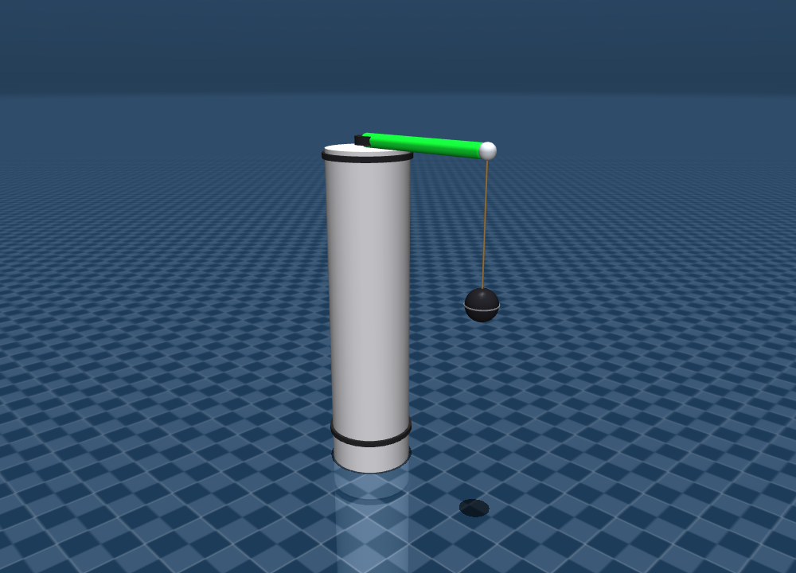
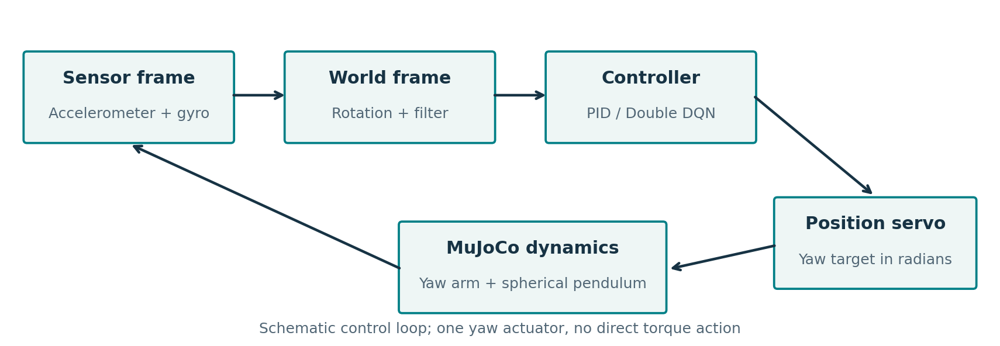
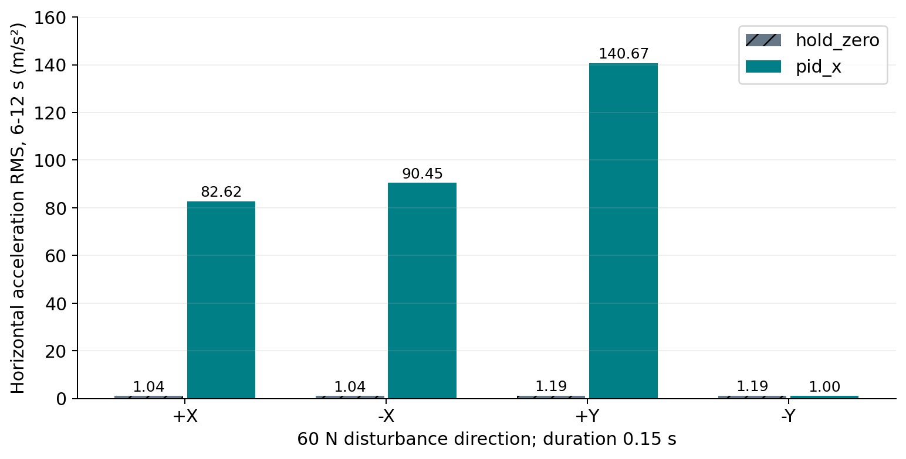

# MuJoCo Pendulum Control: PID and Double DQN

**A yaw-actuated arm, a suspended ball, and a reproducible study of what the controller actually achieves.**

This project by **Alireza Rezaei** models a spherical pendulum attached to a rotating arm in MuJoCo. It includes an acceleration-feedback PID controller and a Double DQN implementation with replay memory, a target network and discrete yaw actions.

The repository preserves the supplied academic project `Project_alireza_rezaei_404012012` and adds a maintained headless workflow, corrected simulation/control interfaces, focused regression tests, measured CSV results and an English technical report.



## Start here

- [Illustrated technical report](docs/Project_Analysis_Report.pdf) - model, mathematics, algorithms, code audit, measured results and next steps.
- [Detailed analysis](docs/ANALYSIS.md) - an accessible text version of the findings and evidence.
- [Verified benchmark data](results/verified/summary.csv) and [execution manifest](results/verified/manifest.json).
- [Original Persian report](docs/original/Project_alireza_rezaei_404012012.pdf), [original source](docs/original/source) and [original figure archive](docs/original/figures).

## What is verified

| Check | Result | Meaning |
| --- | --- | --- |
| Controller regressions | 7 tests passed locally | Units, PID timing/anti-windup, observation/reset behavior, terminal masking and replay sampling |
| Corrected-environment benchmark | 8 runs, 12 seconds each; no simulator warnings | Four fixed force directions, two controller conditions |
| Training-path check | 30 short episodes, 6,000 transitions; optimizer updates exercised | The training and checkpoint-writing paths run; this does not establish convergence |
| Inherited checkpoint | Loaded with `weights_only=True`; one archived-environment replay | Architecture is compatible with the archived code, but training provenance is missing |

The inherited PID gains are **not a validated stabilizing controller**. In the corrected benchmark, they give higher late horizontal acceleration than holding yaw at zero in three of four directions. The archived checkpoint reaches the 800-step time limit without meeting its stability counter in the diagnostic replay. These observations do not establish a general PID-versus-RL ranking.

## Reproduce the maintained workflow

Use Python 3.10+ from a checkout of this repository. The local verification used Python 3.12.9, MuJoCo 3.5.0, NumPy 1.26.4, Matplotlib 3.10.0 and PyTorch 2.4.0. [Verified core versions](requirements-verified.txt) are available; this is not a complete transitive environment lock.

```bash
git clone https://github.com/alirezarezaeei78/Project_alireza_rezaei_404012012.git
cd Project_alireza_rezaei_404012012
python -m venv .venv
# Windows: .venv\Scripts\activate
# macOS/Linux: source .venv/bin/activate
python -m pip install -e .
python -m unittest discover -s tests -v
pendulum-control benchmark --out results/local/benchmark --seconds 12
```

The benchmark needs no display. It saves trajectories, summary metrics, PNG/SVG plots and a configuration/version/hash manifest. Keep new local runs outside `results/verified` to preserve the checked-in evidence.

```bash
# Opt-in training; 1,500 episodes is the original budget, not a convergence guarantee.
pendulum-control train --episodes 1500 --seed 1 --out artifacts/local/training

# Short training-path check, not a performance benchmark:
pendulum-control train --episodes 30 --max-steps 200 --out artifacts/local/smoke

# Optional desktop viewer, with an explicit yaw target in degrees:
pendulum-control view --target-deg 20

# Diagnostic replay of the supplied checkpoint using archived logic:
python scripts/inspect_original.py
```

The viewer requires a working desktop/OpenGL environment. The maintained package does not open a viewer or start training when imported. The historical scripts remain unmodified and retain their original launch behavior. The package expects a repository checkout with `models/rope_arm.xml`; editable installation is the supported setup.

## Model and control loop

The physical hierarchy is `world -> stand -> green_link -> rope_rigid`. The arm has one actuated yaw hinge; the pendulum has an unactuated ball joint. The "rope" is a **single rigid segment**, so the model does not simulate a flexible cable.

| Parameter | Value |
| --- | --- |
| Arm geometry length / mass | 1.00 m / 2.00 kg |
| Pendulum length / ball mass | 0.96 m / 0.50 kg |
| Physics step / control interval | 0.0005 s / 0.005 s |
| Yaw joint and target limits | +/-170 degrees, represented in radians at the servo |
| Position-servo gain / force range | 350 / +/-300 |
| Force disturbance | 60 N for 0.15 s, after 0.25 s undisturbed warm-up |



Accelerometer and gyro values are rotated from the site frame to the world frame. Filtering runs once per physics step. PID regulates the horizontal X acceleration; the DQN observation includes world-frame accelerometer/gyro channels, normalized yaw and command rate. A low-acceleration window is a proxy and cannot establish mechanical stability by itself.

## Double DQN

The network is `8 -> 256 -> 256 -> 2` with ReLU hidden layers. Two actions change the yaw target left or right. A 1.5-degree desired increment is limited to 1.2 degrees per control step by the 240-degree/s common rate cap.

The online network selects the next action and the target network evaluates it. Training uses Adam, Smooth L1 loss, gradient clipping and an epsilon-greedy policy. A true success termination suppresses bootstrapping; a time-limit truncation retains it. [Algorithm and reward details](docs/ANALYSIS.md#double-dqn-and-reward) describe the conditions and the original hyperparameters.

The supplied checkpoint belongs to the archived environment. Correcting command limits, filtering and normalization changes the policy inputs/dynamics. **Retrain and independently evaluate a policy before comparing it with the corrected PID.**

## Fresh benchmark

Same model, disturbance magnitude/duration, horizon, filter/control cadence and command bounds for both conditions. `hold_zero` fixes the yaw target at zero; `pid_x` uses the inherited gains with corrected PID timing and anti-windup. The common command rate is 240 degrees/s; the original PID used 180 degrees/s. These are eight deterministic runs, not repeated statistical trials.



| Kick direction | Hold-zero RMS | PID-X RMS |
| --- | ---: | ---: |
| +X | 1.04 | 82.62 |
| -X | 1.04 | 90.45 |
| +Y | 1.19 | 140.67 |
| -Y | 1.19 | 1.00 |

Units: m/s²; metric window: 6-12 seconds after kick onset. The large kick produces almost full pendulum rotations. Untuned PID, one-axis feedback and direction-dependent control authority all matter; this experiment is outside a small-angle regime. See [complete trajectories](results/verified/acceleration.png), [tilt and command](results/verified/tilt-and-command.png), and the report for interpretation.

## Maintenance findings

- Corrected the original `ctrlrange="-170 170"`, which compiled as +/-170 radians, to the intended +/-170-degree range in radians.
- Replaced oversized legacy constraint allocation with an explicit 64 MB arena after an allocation failure during local benchmarking.
- Used the 5 ms control interval for PID differentiation and integration; the original derivative divided by the 0.5 ms physics step.
- Moved undisturbed calibration ahead of the kick; the original calibration overlapped it.
- Made observations read-only and updated filters once per physics step; the archived RL path updates the filter twice for a single endpoint reading.
- Separated success termination from time-limit truncation and prevented success counting before the kick ends.
- Added portable paths, explicit CLI commands, saved CSVs/manifests, safe checkpoint loading and a compatible viewer entry point.

These changes alter the experimental setup. Historical PNGs and the supplied policy are retained as original artifacts, not presented as results of the maintained code.

## Repository map

```text
src/pendulum_control/  shared simulator, PID, Double DQN and CLI
models/               maintained MJCF model
tests/                focused controller/learning regressions
docs/                 illustrated report, analysis and scientific figures
docs/original/        original report, source, figures and hash manifest
artifacts/checkpoints/ supplied historical DQN weights
results/verified/     fresh matched benchmark and raw numerical trajectories
results/legacy-replay/ archived checkpoint diagnostic
results/training-smoke/ short execution check and metadata
scripts/              artifact inspection and report/figure generation
```

## Next work

Tune an interpretable controller on a separate development set, then test held-out forces, directions and initial pendulum angles. Add angle/velocity criteria and persistent settling metrics, randomize training disturbances, retrain Double DQN under the corrected environment, and report repeated seeds and uncertainty. Hardware transfer requires a separate physical-model and safety validation effort.

Maintained by [Alireza Rezaei](https://www.linkedin.com/in/alireza-rezaei-24963a210/). Original academic artifacts are preserved with a [SHA-256 manifest](docs/original/manifest.json). No software license was supplied with the archive; this repository does not grant additional reuse rights. Dependency licenses remain with their respective authors.
